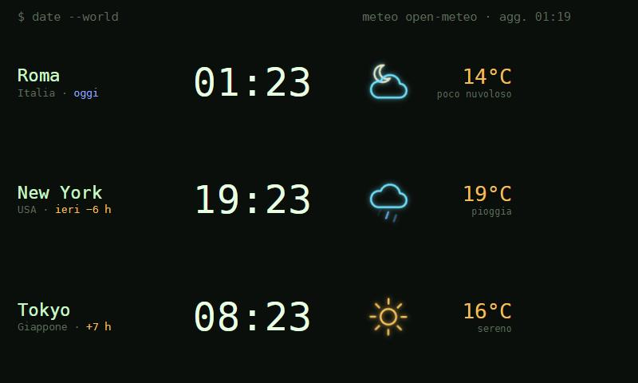

# World Clock (Orologio) per DeskThing

🇬🇧 [Read in English](README.md)

Un'app [DeskThing](https://deskthing.app) per lo Spotify **Car Thing**: l'ora di **tre località**,
ognuna con la temperatura e un'**icona meteo neon animata**, in stile terminale.



*Screenshot alla risoluzione del Car Thing (800×480), con città di esempio.*

- Ora e fuso di ogni città, con la differenza rispetto alla prima ("−6 h", "domani +5 h").
  L'ora legale è gestita in automatico.
- Meteo da [Open-Meteo](https://open-meteo.com) (gratuito, senza chiave), aggiornato ogni 15 minuti.
- Icone neon animate: sereno (giorno/notte), poco nuvoloso (giorno/notte), coperto, pioggia,
  temporale, neve, nebbia.
- Mentre l'orologio è sullo schermo, gli eventi importanti **cambiano app** sul Car Thing:
  Pi fa una domanda o finisce un lavoro → [Pi Status](https://github.com/franzo-ux/deskthing-pi-status);
  un servizio va giù → [Stack Status](https://github.com/franzo-ux/deskthing-stack-status).

## Requisiti

- Un Car Thing con il firmware per DeskThing, collegato a un PC con **DeskThing ≥ 0.11**.
- **Node.js ≥ 20** sul PC (serve solo per compilare l'app). Il PC deve essere online per il meteo.

## Compilare e installare

```bash
npm install
npm run build          # → dist/worldclock
# chiudi DeskThing (icona vicino all'orologio → Esci), poi:
npm run deploy         # copia l'app in DeskThing e la registra
```

Riapri DeskThing e apri **Orologio** sul Car Thing. Per aggiornare in futuro: `npm run build`,
`npm run deploy -- --files`, riavvia DeskThing.

## Impostazioni (DeskThing → App → Orologio)

Per ognuna delle 3 città: **nome**, **sottotitolo** (paese/regione), **latitudine**, **longitudine** e
**fuso orario** (nome IANA, es. `Europe/Rome`, `America/New_York`, `Asia/Tokyo`).

Coordinate e fuso di un luogo si trovano con la ricerca di Open-Meteo:

```bash
curl "https://geocoding-api.open-meteo.com/v1/search?name=Tokyo&count=1&language=it"
```

Cambio automatico di app (facoltativo, servono quelle app installate):

| Impostazione | Significato |
|---|---|
| Passa a Pi Status | passa a Pi Status quando Pi ti chiede qualcosa o finisce |
| Passa a Homelab | passa a Stack Status quando un servizio va giù |
| Indirizzo stato Pi | URL del servizio di stato di Pi, es. `http://pi-host.local:8765/status` |

## Come funziona

- L'orologio del Car Thing non è sincronizzato, quindi il PC manda la propria ora ogni 5 s insieme
  allo scarto da UTC di ogni città (calcolato con i fusi orari del PC); il display conta solo i secondi.
- Una sola richiesta a Open-Meteo restituisce temperatura, codice meteo WMO e giorno/notte per tutte
  e tre le città.
- Il cambio di app usa l'azione "Open App" di DeskThing, lanciata dall'app che è sullo schermo.

## Licenza

[MIT](LICENSE): puoi usarlo, modificarlo e condividerlo liberamente.
